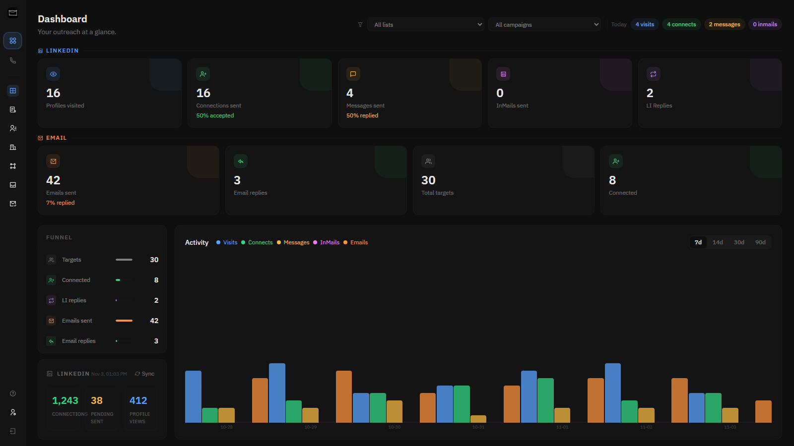
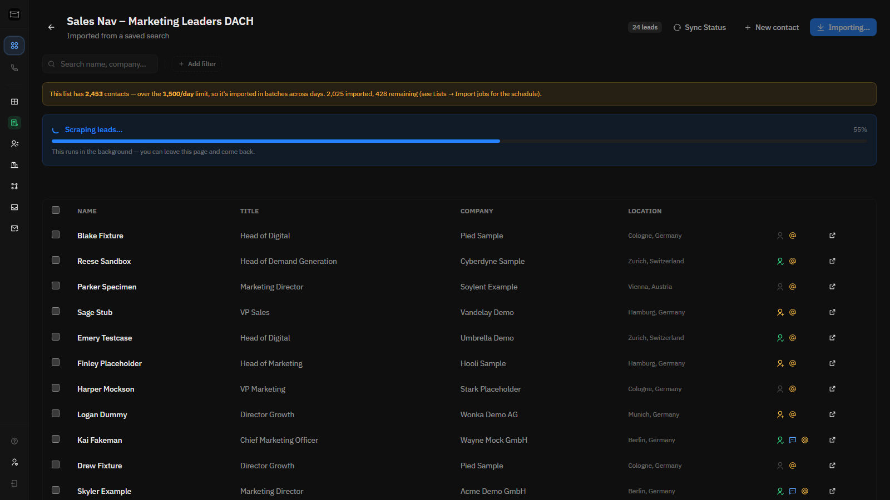
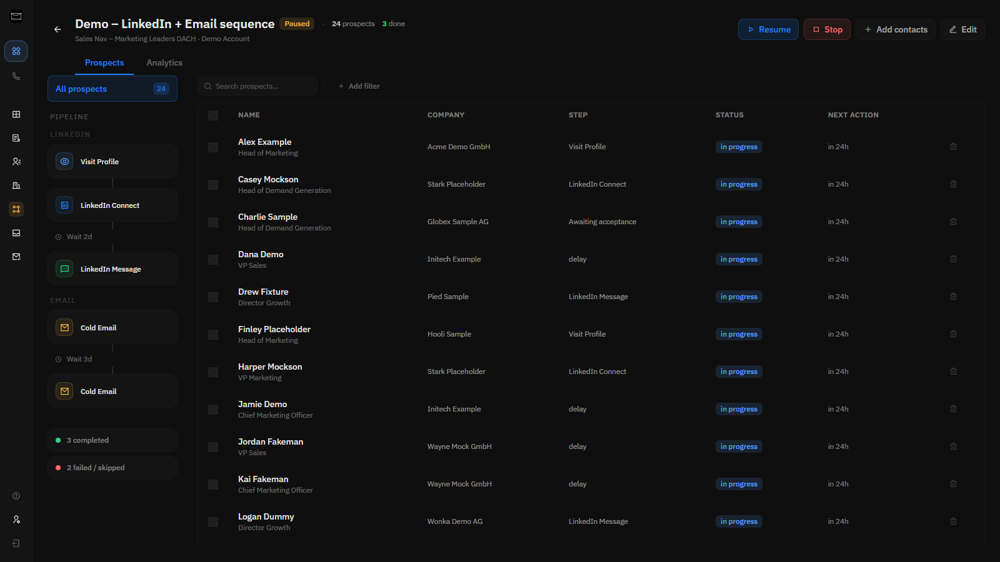
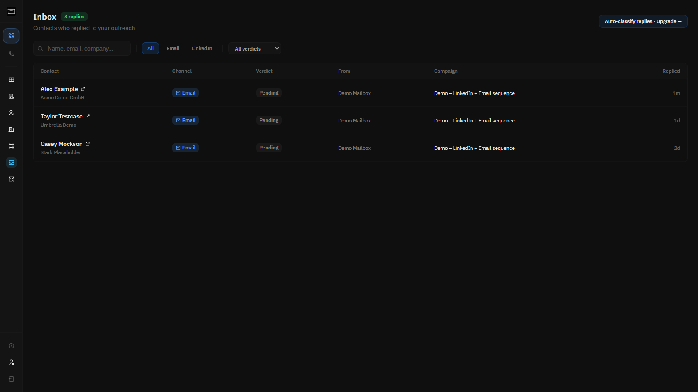
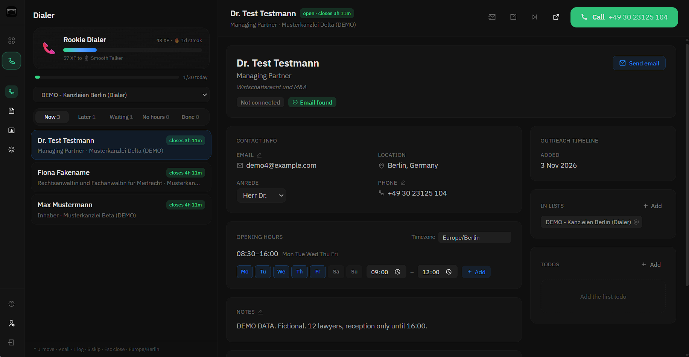
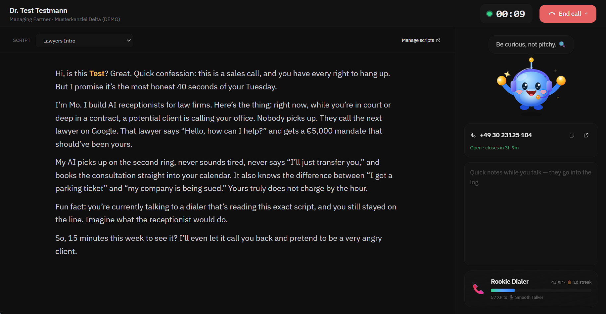
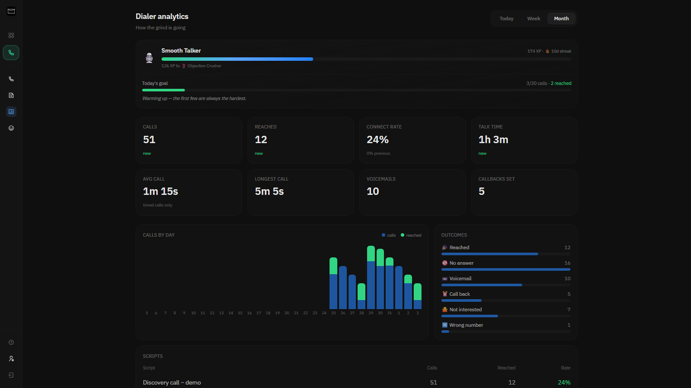
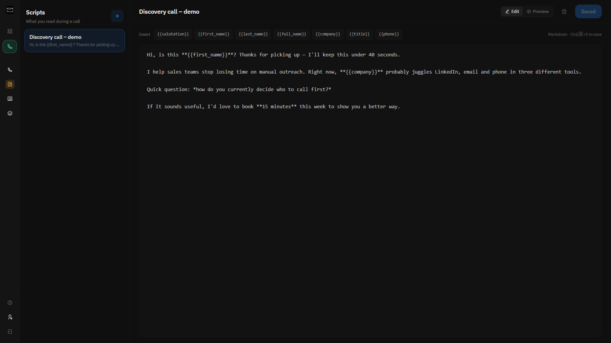

<p align="center">
  
</p>

<h1 align="center">Linki</h1>
<p align="center">Open-source AI SDR for B2B outreach. LinkedIn sequences, cold email, calling and lead enrichment. Self-hosted, no per-seat pricing.</p>

<p align="center">
  <a href="https://opsily.com/hosting/linki?utm_source=github&utm_medium=readme&utm_campaign=linki">
    
  </a>
  &nbsp;
  <a href="https://discord.gg/8VPeFDJMn">
    
  </a>
</p>

---

<p align="center">
  <strong>▶ Full demo &nbsp;|&nbsp;</strong>
  <a href="https://youtu.be/S6n4RHULq3E">https://youtu.be/S6n4RHULq3E</a>
</p>
<p align="center">
  <a href="https://youtu.be/S6n4RHULq3E">
    
  </a>
</p>

---

## Why I built Linki

I do B2B outreach myself, and I got tired of paying per seat for tools that hide what they do with my data. So I built the one I wanted: you build campaigns across LinkedIn, email and phone, enrich your leads, and run all of it on your own server. Your data stays with you.

No SaaS middleman. No per-seat pricing. No black box. I use it every day, and I keep shipping what I need next.

---

## Outreach workspace

<table>
  <tr>
    <td width="50%"><br/><sub><b>Dashboard</b>: LinkedIn and email activity, funnel and account stats in one place</sub></td>
    <td width="50%"><br/><sub><b>Sales Navigator import</b>: big lists are scraped in batches under a daily cap</sub></td>
  </tr>
  <tr>
    <td width="50%"><br/><sub><b>Campaigns</b>: LinkedIn and email tracks side by side, with every lead's step visible</sub></td>
    <td width="50%"><br/><sub><b>Inbox</b>: everyone who replied, across email and LinkedIn</sub></td>
  </tr>
</table>

## Dialer

<table>
  <tr>
    <td width="50%"><br/><sub><b>Call queue</b>: who to call right now, based on opening hours and timezone</sub></td>
    <td width="50%"><br/><sub><b>Call wizard</b>: script, timer and notes on one screen</sub></td>
  </tr>
  <tr>
    <td width="50%"><br/><sub><b>Analytics</b>: calls, connect rate, talk time and outcomes</sub></td>
    <td width="50%"><br/><sub><b>Scripts</b>: Markdown with personalization variables</sub></td>
  </tr>
</table>

*All screenshots use fictional demo data.*

---

## Features

### 📬 Multichannel campaigns

- **LinkedIn + email in one campaign**: LinkedIn actions (visit, connect, message) and email steps run in parallel inside a single sequence
- **Flexible step builder**: chain visit → connect → delay → message → cold email in any order, with delays between steps
- **Per-lead tracking**: see exactly where every lead is on both channels, with a live pipeline broken down by step and status
- **A/B template pools**: give a step several templates and Linki rotates them for you

### 🔐 Server-side LinkedIn login

- **Headless login on your server**: no cookie pasting. The session is born under the exact browser fingerprint the automation uses
- **Handles LinkedIn's real challenges**: email/SMS codes **and** mobile-app device approval
- **Longer, steadier sessions**: a pinned browser fingerprint means far fewer forced logouts
- **Full session capture**: including the httpOnly Sales Navigator seat cookie that cookie pasting can't reach, so Sales Nav import and enrichment just work

### 🔍 Data & enrichment

- **Sales Navigator import**: paste a list URL and Linki pulls in every lead with name, title, company, location, seniority and LinkedIn URL
- **CSV import**: bring leads from anywhere. One template covers LinkedIn URL, Sales Nav URL, email and every contact field. Each row only needs a LinkedIn URL and/or an email
- **Batched, scheduled imports**: large lists are split across days under a global daily cap, with human-like pacing so an import never looks like a bot burst
- **Apollo.io enrichment**: connect your API key and enrich a list with verified emails, company data and seniority in one click
- **Sales Nav profile enrichment**: headline and positions for better targeting, gathered by the runner at a natural pace
- **Company model**: enriched company records (description, headcount, industry, location) linked from contacts and never duplicated
- **Contact pages**: full profile, outreach history, enrichment status and campaign activity per contact

### 📞 Built-in dialer

- **Call queue**: every contact with a phone number, sorted into *call now / later today / waiting / no hours / done* by their opening hours and timezone
- **Opening hours per contact**: call windows per weekday in the contact's own timezone, so you ring people when they pick up
- **Call wizard**: one full-screen flow with script, timer, outcome (reached, no answer, voicemail, call back, not interested, wrong number) and notes, then straight to the next call
- **Scripts**: Markdown call scripts with `{{first_name}}`-style variables. Pick one per call and see which script each call used in your analytics
- **Analytics & daily goal**: calls, talk time and outcomes over time, plus a daily goal bar and a small cheerleader to keep you dialing
- **Everything logged**: every call lands on the contact's activity timeline

### 📥 Unified inbox

- **One reply feed**: email replies from all active campaigns in one inbox, whichever mailbox received them
- **Email + LinkedIn reply detection**: the runner passively watches both channels and flags contacts who replied
- **Noise-free**: only shows people who actually replied
- **Inline composer**: read the full thread and answer without leaving Linki

### ⚡ Reliability & safety

- **Pinned browser fingerprint**: Chromium and its base image are version-pinned, so a rebuild never changes what LinkedIn sees. That was the biggest cause of forced logouts, and it's gone
- **63% better connection reliability**: rewritten LinkedIn automation with smarter DOM targeting, clipboard-based message delivery and graceful handling of LinkedIn's UI variants
- **Human-like imports**: randomized delays and pacing to stay clear of bot detection
- **Email ramp-up**: new mailboxes warm up gradually so you build sender reputation safely
- **Multiple accounts**: as many SMTP/IMAP and LinkedIn accounts as you need, each with its own daily limits
- **Daily limits with auto-reschedule**: hit your cap and the runner moves the work to tomorrow instead of stopping the campaign

### 📊 Analytics

- **Campaign pipeline**: funnel by step with prospect counts. Click a step to see the exact contacts in it
- **Stats bar**: prospects, in progress, completed, failed/skipped, connections sent, accepted and messages sent
- **Acceptance rate**: connection request to acceptance, per campaign
- **Dashboard**: active runs, total contacts and recent activity across campaigns

---

## What's new

- **Built-in dialer**: a full cold-calling workspace with a call queue driven by opening hours and timezones, a call wizard with scripts and outcome logging, call analytics and a daily goal. A new tab switcher in the sidebar flips between *Workspace* and *Dialer*
- **Salutation field**: German-style *Anrede* (or any greeting you like) on every contact, usable as `{{salutation}}` in templates and email subjects
- **Send email from Contacts**: click a contact's email to write and send straight from Linki. Sent mail lands on their timeline
- **Email preview with a real lead**: pick an actual contact in the campaign builder and preview your email with their data filled in
- **Add a contact right from a list**: the LinkedIn URL is now optional (email-only leads are first-class) and every contact field is editable
- **Lists remember your page**: go back from a contact and you land on the same page of the list
- **Replies always unenroll**: any email reply takes the lead out of the sequence immediately, and nothing automatic can put them back
- **Sturdier reply sync**: one lightweight scan per mailbox instead of a search per lead, with a hard timeout so a hung mail server can never stall your campaigns
- **CSV import**: bring your own leads from any source. One template covers everything, and each row just needs a LinkedIn URL and/or an email
- **Generic inboxes supported**: role-based addresses (`info@`, `contact@`, `sales@`) import as normal contacts, ready for email-only campaigns
- **Phone number field**: track a phone alongside email and LinkedIn, editable on the contact page or via CSV/API
- **Bulk contact deletion**: delete contacts (and their run history) from the Contacts page, with a confirmation step
- **Server-side headless LinkedIn login**: logs in on your server (email/SMS code **or** mobile-app approval) and captures the full session, including the Sales Navigator seat cookie
- **Pinned browser fingerprint**: Chromium and the base image are version-pinned so rebuilds never trigger a forced logout
- **Batched, scheduled imports**: big Sales Nav lists split across days under a global daily cap
- **Better reply sync**: reply detection for **both** email and LinkedIn, with accurate accepted-connection sync through LinkedIn's own APIs
- **Lead enrichment built in**: Apollo.io and Sales Nav profile enrichment, one click on any list

---

## Hosting options

### One-click on Opsily (recommended)

[Opsily](https://opsily.com/hosting/linki?utm_source=github&utm_medium=readme&utm_campaign=linki) is the easiest way to run Linki. Create a server, deploy Linki from the app store and you get a live URL in under a minute. No terminal needed.

[](https://opsily.com/hosting/linki?utm_source=github&utm_medium=readme&utm_campaign=linki)

### Self-host with Docker

**1. Create your environment file**

```bash
cp .env.example .env.local
```

Fill in `.env.local`:

```env
# Public URL of the app (e.g. https://linki.yourdomain.com or http://localhost:3456)
NEXTAUTH_URL=http://localhost:3456

# Random secret: generate with: openssl rand -base64 32
NEXTAUTH_SECRET=your_random_secret_here

# Password to log in to the Linki UI
AUTH_PASSWORD=your_password_here
```

**2. Start the container**

```bash
docker compose up -d
```

Or pull the image directly:

```bash
docker run -d -p 3456:3000 \
  -e NEXTAUTH_URL=http://localhost:3456 \
  -e NEXTAUTH_SECRET=your_random_secret_here \
  -e AUTH_PASSWORD=your_password_here \
  -v $(pwd)/data:/data \
  moaljumaa/linki:latest
```

Linki is now running at `http://localhost:3456`. The SQLite database lives in `./data/linki.db` on your host machine.

### Self-host manually (Node.js)

Requires Node.js 22+.

```bash
npm install
npm run build
npm start
```

---

## Setup

### 1. Add a LinkedIn account

Go to **Settings → LinkedIn** and add your account. Start with conservative daily limits (I recommend 20 connections/day and 30 messages/day).

### 2. Authenticate LinkedIn

Click **Authenticate** and choose **Server login**. Linki logs in on the server and walks you through LinkedIn's verification (email/SMS code, or a tap in the LinkedIn mobile app). You get a full, long-lived session, including the Sales Navigator seat you need for imports.

### 3. Add email accounts (optional)

Go to **Settings → Email** and add your SMTP/IMAP accounts, as many as you like. Turn on ramp-up for new mailboxes so your sender reputation builds gradually.

### 4. Connect Apollo (optional)

Go to **Settings → Integrations** and add your Apollo API key. Then open any list and click **Enrich** to pull in verified emails and company data.

### 5. Import a lead list

Go to **Lists → New list** and paste a LinkedIn Sales Navigator list URL. Linki imports the leads with human-like pacing.

> **Note:** You need a LinkedIn Sales Navigator subscription to import leads.

### 6. Build and launch a campaign

Go to **Workflows → New workflow**. Add your steps (LinkedIn actions, email steps, delays), write your messages or use templates and A/B pools, then create a run and launch it.

### 7. Call your leads (optional)

Add phone numbers and opening hours to your contacts, switch to the **Dialer** tab in the sidebar, and work the queue.

---

## Managed edition

Everything above is open source and runs on your own machine. If you'd rather not manage servers, or you want the AI features on top, the managed edition on **[Opsily](https://opsily.com/hosting/linki?utm_source=github&utm_medium=readme&utm_campaign=linki)** adds an **AI agent that writes every message per lead** (any model via OpenRouter), a **hosted MCP endpoint** so you can drive Linki from Claude or Cursor, **automatic AI reply handling**, and **Sales Navigator InMail**. [Deploy in a minute →](https://opsily.com/hosting/linki?utm_source=github&utm_medium=readme&utm_campaign=linki)

---

## License

Linki is source-available under the [Linki Sustainable Use License](LICENSE).

**You can:** use it personally, use it for your business, self-host it on your own VPS or laptop, modify it, and contribute to it.
